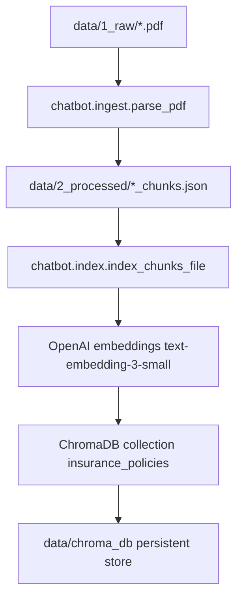
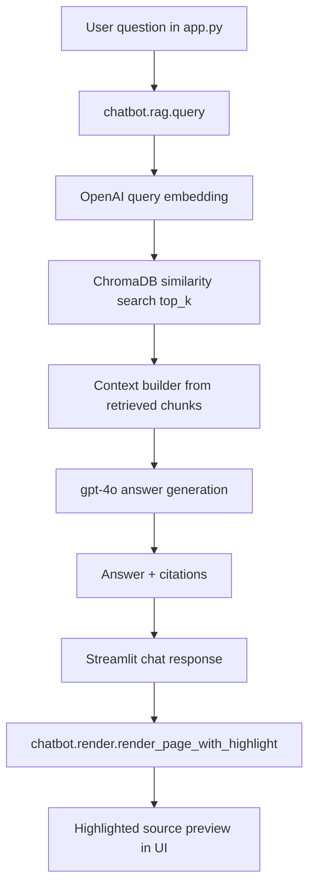
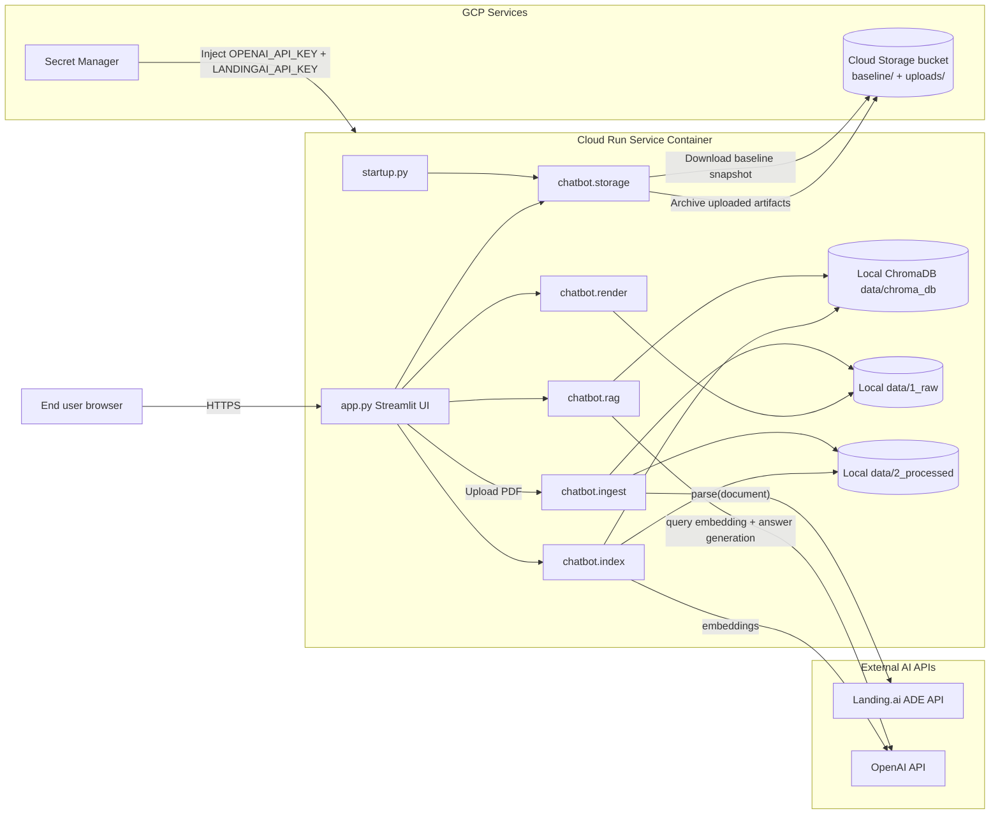

# Architecture Documentation

This document explains the system structure, data flow, and function-level behavior.

## 1) Commented folder structure

```text
AIChatbot/
├── app.py                     # Streamlit UI entrypoint (chat, uploads, view modes, citations)
├── startup.py                 # Cloud Run startup script (sync baseline from GCS, then run Streamlit)
├── Dockerfile                 # Container build definition for Cloud Run
├── .dockerignore              # Exclusions for container build context
├── pyproject.toml             # Poetry config + dependencies
├── poetry.lock                # Locked dependency graph
├── .env.example               # Environment variable template
├── chatbot/
│   ├── __init__.py
│   ├── ingest.py              # PDF -> ADE chunks JSON pipeline
│   ├── index.py               # Chunks JSON -> embeddings -> ChromaDB
│   ├── rag.py                 # Retrieval + LLM answer generation + citations
│   ├── render.py              # PDF page rendering + bbox highlight image
│   └── storage.py             # GCS baseline sync + uploads archival helpers
├── data/
│   ├── 1_raw/                 # Source PDFs used by app/indexing
│   ├── 2_processed/           # Parsed chunk JSON files
│   └── chroma_db/             # Local ChromaDB persistent index
├── docs/
│   ├── ARCHITECTURE.md        # This document
│   └── questions.md           # User/demo question notes
└── tests/
    └── __init__.py
```

## 2) System flows

### 2.1 Ingestion + indexing flow (build phase)



### 2.2 Runtime Q&A flow (operation phase)



### 2.3 Component diagram (with communication links)



Communication summary:

- **Browser ↔ Cloud Run (`app.py`)**: interactive chat over HTTPS.
- **`startup.py` ↔ GCS (`baseline/`)**: restores canonical dataset at container startup.
- **`app.py` ↔ `chatbot.ingest` ↔ Landing.ai ADE**: extracts structured chunks from uploaded PDFs.
- **`chatbot.index` ↔ OpenAI**: generates embeddings for chunk indexing.
- **`chatbot.rag` ↔ OpenAI + ChromaDB**: embeds user query, retrieves top-k chunks, generates grounded answer.
- **`app.py` ↔ `chatbot.render`**: renders highlighted PDF source pages from citation metadata.
- **`chatbot.storage` ↔ GCS (`uploads/`)**: archives uploaded PDFs/chunks separately from baseline snapshot.

## 3) File-by-file + function-by-function explanation

## `app.py`

Main Streamlit app and user interaction orchestration.

- `_source_to_pdf(source: str) -> Path | None`
  - Maps citation source names back to `data/1_raw/<source>.pdf`.
- `_available_docs() -> list[str]`
  - Lists available PDF stems for document scope selector.
- `_archive_upload_if_enabled(pdf_path, chunks_path) -> None`
  - Archives uploads to GCS when `GCS_BUCKET_NAME` is configured; no-op in local mode.
- `_render_citation_expanders(citations) -> None`
  - Integrated mode source previews in expandable sections.
- `_render_citation_labels(citations) -> None`
  - Side-by-side mode compact citation labels under each assistant message.
- `_render_doc_panel(citations, nav_index) -> None`
  - Right-side source viewer with prev/next navigation and highlighted page rendering.
- `_process_prompt(prompt, source_filter) -> None`
  - Calls RAG query, updates session state, appends assistant response, reruns UI.
- `_upload_dialog(doc_name) -> None`
  - Post-upload dialog to optionally switch scope and clear conversation.
- `_init_state() -> None`
  - Initializes session state keys for messages, citations, UI mode, upload flags.

Top-level app flow:
- Loads env and sets page config
- Renders settings sidebar (layout mode, document scope, upload, clear chat)
- Renders conversation based on selected layout
- Uses `st.chat_input` (bottom-pinned input) and forwards prompt to `_process_prompt`

## `chatbot/ingest.py`

Parses PDFs into structured chunk JSON using Landing.ai ADE.

- `validate_env() -> str`
  - Ensures `LANDINGAI_API_KEY` exists and returns it.
- `parse_pdf(client, pdf_path, out_dir) -> int`
  - Parses one PDF, serializes ADE chunk models to JSON, returns chunk count.
  - Skips if output chunk file already exists.
- `main() -> None`
  - Batch runner for all PDFs in `data/1_raw`, writes outputs to `data/2_processed`.

## `chatbot/index.py`

Builds/updates vector index in ChromaDB.

- `get_collection(chroma_dir=CHROMA_DIR) -> chromadb.Collection`
  - Creates/loads persistent collection `insurance_policies` with cosine distance.
- `embed_texts(openai_client, texts) -> list[list[float]]`
  - Calls OpenAI embeddings API for a batch of texts.
- `index_chunks_file(chunks_path, collection, openai_client) -> int`
  - Loads one chunk JSON file and upserts IDs, vectors, docs, metadata.
  - Metadata includes source, page, chunk type, and bbox coordinates.
- `index_all(processed_dir=PROCESSED_DIR) -> None`
  - Runs indexing across all `*_chunks.json` files.
- `main() -> None`
  - Validates key, ensures db dir exists, runs full indexing.

## `chatbot/rag.py`

Retrieval + answer generation with citations.

- `Citation` (dataclass)
  - Source + page + bbox metadata for UI previews.
- `RAGResponse` (dataclass)
  - Final answer text and citation list.
- `_clean_markdown(text) -> str`
  - Removes ADE anchor tags from chunk markdown.
- `_build_context(documents, metadatas) -> str`
  - Formats retrieved excerpts into model prompt context.
- `_extract_citations(metadatas) -> list[Citation]`
  - Deduplicates source/page combinations and extracts bbox values.
- `query(question, source_filter=None, top_k=TOP_K, chroma_dir=None) -> RAGResponse`
  - Embeds query, retrieves top-k chunks from ChromaDB, prompts LLM, returns answer+citations.
- `main() -> None`
  - CLI smoke test with sample questions.

## `chatbot/render.py`

PDF visualization helper for citation preview.

- `render_page_with_highlight(pdf_path, page_number, box_left, box_top, box_right, box_bottom, zoom=RENDER_ZOOM) -> bytes`
  - Renders target page with semi-transparent highlighted rectangle and returns PNG bytes.
- `pdf_page_count(pdf_path) -> int`
  - Utility to get number of pages.

## `chatbot/storage.py`

GCS integration for baseline sync and upload archive.

- `_bucket_name() -> str | None`
  - Reads `GCS_BUCKET_NAME`.
- `gcs_enabled() -> bool`
  - Returns whether GCS mode is enabled.
- `_prefix(name, default) -> str`
  - Reads normalized prefix env var.
- `_client() -> storage.Client`
  - Creates GCS client using configured project.
- `sync_baseline_from_gcs(local_data_dir) -> bool`
  - Downloads baseline snapshot into local `data/` and resets existing local data.
- `archive_uploaded_artifacts(pdf_path, chunks_path=None) -> None`
  - Uploads runtime user artifacts to `uploads/` GCS prefix.

## `startup.py`

Cloud Run process entrypoint.

- `main() -> None`
  - Calls baseline sync from GCS, then launches Streamlit on `$PORT`.
  - Keeps startup logic explicit and separate from UI logic.

## `Dockerfile`

Container runtime definition:
- Uses `python:3.12-slim`
- Installs Poetry
- Installs dependencies from lock file
- Copies app code
- Runs `python startup.py`

## 4) Why two diagrams (and not one)?

Two diagrams are clearer because the system has two distinct phases:

- **Build/indexing phase**: PDF preprocessing + vector index creation
- **Runtime phase**: question answering over existing vector index

A single diagram can be done, but it becomes harder to reason about operational responsibilities and failure points.

## 5) Operational notes

- Default retrieval uses `TOP_K = 3` (cleaner citations and previews).
- In cloud mode, baseline and uploads are intentionally separated:
  - baseline restored on startup
  - uploads archived but not auto-loaded at restart
- In local mode (no `GCS_BUCKET_NAME`), app runs entirely on local files.

